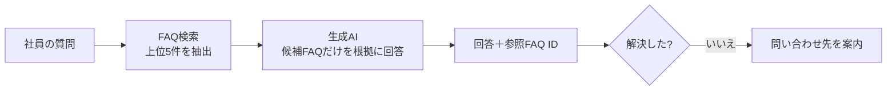

# 社内ITヘルプデスク FAQボット（PoC）

架空のIT企業「TechBridge Solutions株式会社」（従業員200名）を想定した、社内ITヘルプデスク向けFAQボットの試作です。
社員が自然な言葉で質問すると、社内FAQから関連する情報を検索し、その内容だけをもとに回答します。

> 本リポジトリの企業名・システム名・連絡先・社内規程はすべて架空のテストデータです。

## 背景と課題

情シス担当者が2名しかおらず、VPN接続やパスワードリセットなど同じ問い合わせに何度も対応している、という状況を想定しています。

| 現状 | 目指す姿 |
|---|---|
| 社員がTeamsで質問し、情シスが毎回回答 | 社員がFAQボットに質問し、即時に自己解決 |

## 構成（検索拡張生成 / RAG）



- **検索**：文字バイグラムとIDFによるキーワード検索（ブラウザ内で動作）
- **生成**：生成AI（Claude）に、候補FAQの内容だけを根拠に回答するよう指示
- **ハルシネーション対策**：FAQにない手順・URL・連絡先を作らない、根拠がなければ「該当なし」と答えて問い合わせ先を案内する
- **根拠の明示**：回答ごとに参照したFAQ IDと、検索された候補・一致度を表示

## 機能

- **質問する**：チャット形式で質問。回答の根拠と「解決した／解決しない」のフィードバック付き
- **テスト**：26問の評価用質問を一括実行し、OK／部分的／NGを判定して正答率を集計
- **FAQ一覧**：8カテゴリ・50件のFAQをカテゴリとキーワードで閲覧

## 評価結果

| 指標 | 結果 | 説明 |
|---|---|---|
| 検索ヒット率（上位5件） | 83%（20/24） | 検索候補に期待するFAQが含まれた割合（範囲外の質問2問を除く） |
| 回答の正答率 | 92% | 26問を人が判定した結果 |

検索で取りこぼした質問は「ログインパスワードがわからなくなった」「パソコンが重くて仕事にならない」など、FAQと言葉が異なる言い換えでした。
キーワード検索の限界であり、意味で探すベクトル検索（Azure AI Search等）で改善できる見込みです。詳細は [docs/evaluation.md](docs/evaluation.md) を参照してください。

## 担当範囲と学んだこと

### 担当範囲

個人で企画から評価までを行いました。

| 工程 | 内容 |
|---|---|
| 企画・要件定義 | 想定企業（ペルソナ）と課題の設定、対象とする問い合わせカテゴリの選定 |
| データ設計 | FAQ 50件と評価用質問26問の作成方針の決定（口語・言い換え・緊急事案・範囲外の質問を含める） |
| 実装 | 生成AI（Claude）を活用してプロトタイプを実装し、動作を検証 |
| 評価・分析 | 26問の回答を判定し、NGの原因を「検索ミス」と「生成ミス」に切り分けて分析 |
| 環境調査 | Microsoft 365・Copilot Studioのライセンス体系と、検証環境の用意の仕方を調査 |

### 学んだこと

- **RAGの回答品質は検索で決まる**：検索と生成の2段構成では、検索で正解を拾えないと生成AIも正しく答えられません。検索ヒット率（83%）を回答の正答率と分けて測ることで、どこを改善すべきかが明確になりました。
- **キーワード検索は言い換えに弱い**：「パソコンが重い」と「PCの動作が遅い」のように、意味が同じでも言葉が違うと見つけられません。ベクトル検索が必要になる理由を、実際のデータで確認できました。
- **評価は仕組みとして回す**：評価セット、指標、原因の切り分け、改善、再評価という流れで改善します。回答の見た目がよくても、根拠にしたFAQが期待どおりかを確認しないと判定が甘くなることも分かりました。
- **ハルシネーション対策は指示文で設計する**：回答の根拠をFAQに限定する、参照したFAQ IDを必ず示す、範囲外の質問は断って問い合わせ先を案内する、といったルールを指示文に組み込みました。
- **導入には環境とライセンスの検討が欠かせない**：Copilot StudioやSharePointの検証には組織テナントが必要で、Copilot StudioはMicrosoft 365とは別ライセンスです。技術だけでなく、導入時のコストや環境の検討も重要だと分かりました。

## ロードマップ

| 段階 | 内容 | 状態 |
|---|---|---|
| 0 | 生成AIで試作し、会話設計・指示文・評価方法を検証 | 完了 |
| 1 | Microsoft Copilot Studioでエージェント化（Generative Answers・トピック設計） | 予定 |
| 2 | SharePointをナレッジ元にしたFAQ管理・文書検索 | 予定 |
| 3 | Power Automateで問い合わせ履歴の保存とTeams通知 | 予定 |
| 4 | Azure OpenAI＋Azure AI SearchによるRAG構成、ベクトル検索で検索精度を改善 | 予定 |

各段階で同じFAQデータ・同じ評価セットを使い、精度の変化を比較します。

## ファイル構成

```
index.html                         ボット本体（1ファイルで動作）
data/faq.json                      FAQ 50件
data/tests.json                    評価用の質問 26問
data/TechBridge_ITヘルプデスクFAQ.xlsx  FAQと評価シート（SharePointリスト・Copilot Studioへの取り込み用）
docs/evaluation.md                 評価の方法と結果
```

## 動かし方

`index.html` をブラウザで開くか、GitHub Pagesで公開すると動作します。
単体で開いた場合は生成AIに接続しない「検索のみモード」で動き、検索でいちばん近いFAQをそのまま表示します。
